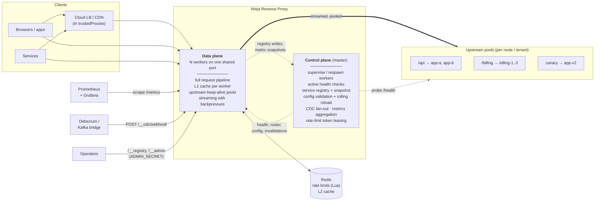
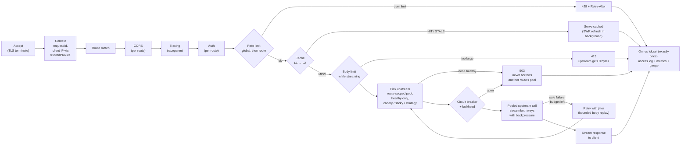

# Ninja Reverse Proxy

A Layer 7 reverse proxy and load balancer for Node.js, written in TypeScript. It runs as a multi-process cluster in which every worker accepts connections and streams traffic end to end, and it is built for multi-tenant use: routes are isolated from each other, client IPs are trusted only from declared proxies, and runtime upstream registration is protected against SSRF.


```bash
npm install ninja-reverse-proxy
npx ninja-reverse-proxy --config config.yaml
```

---

## Contents

- [Highlights](#highlights)
- [Architecture](#architecture)
- [Features](#features)
- [Performance](#performance)
- [Verified behaviour](#verified-behaviour)
- [Security defaults](#security-defaults)
- [Testing](#testing)
- [Quick start](#quick-start)
- [Configuration](#configuration)
- [Operations](#operations)
- [Known limitations and roadmap](#known-limitations-and-roadmap)
- [Documentation](#documentation)

---

## Highlights

- **Streaming datapath.** Request and response bodies are piped with native backpressure and are never held in memory whole. A 100 MB upload passes through with a SHA-256 match while proxy memory grows by about 43 MB.
- **Every worker serves traffic.** Workers share the listening port and run the full pipeline themselves. The master is control-plane only and uses about 0.3% of total proxy CPU under load.
- **12 load-balancing strategies**, 5 rate-limiting algorithms, classic and adaptive circuit breakers, retries with budgets and jitter, bulkheads, and an L1/L2 cache with CDC invalidation.
- **Exactly-once retries for unsafe methods.** Under 1,500 concurrent 64 KB POSTs, the upstream receives every request exactly once.
- **Operable in production.** Includes hot config reload, graceful shutdown, automatic worker respawn, Prometheus metrics, W3C trace context, readiness and liveness endpoints, and access logs with request IDs.
- **Tested against the real binary.** Behavioural suites start the built proxy as separate processes with real upstreams and a real Redis. Mocks are not used to produce pass results.

---

## Architecture

[](https://excalidraw.com/#json=6b4-iDt2VNYEa5rgLmbhb,2ArESOtYrPS2WS3efvUtIw)

**[Open the interactive diagram in Excalidraw →](https://excalidraw.com/#json=6b4-iDt2VNYEa5rgLmbhb,2ArESOtYrPS2WS3efvUtIw)**

### System view



### Request lifecycle inside a worker



**Data plane (workers).** Every worker accepts connections on the shared port and runs the whole pipeline above. Request and response bodies are streamed with backpressure over pooled keep-alive connections. No request or response data crosses process boundaries, so throughput scales with the number of workers.

**Control plane (master).** The master never touches traffic. It supervises workers (a crashed worker is respawned in well under a second) and runs health checks. It owns the service registry and validates and rolls out new configuration. It also fans CDC cache invalidations out to every worker, aggregates metrics, and leases rate-limit tokens across workers when Redis is not configured.

**Logging and metrics.** Every request, including `429`, `413`, `503`, CORS preflights, cache hits and client aborts, is recorded exactly once. A single `res.once('close')` hook writes the access-log line, the Prometheus sample and the active-connection gauge, so no response path can skip or double-count them.

Design details: [docs/08-master-worker-architecture.md](./docs/08-master-worker-architecture.md) · [docs/10-middleware-pipeline.md](./docs/10-middleware-pipeline.md)

---

## Features

| Area | Capabilities |
|---|---|
| **Load balancing** | Round robin, weighted round robin (smooth, nginx-style), least connections, weighted least connections, least response time (EWMA), power of two choices, consistent hashing (virtual nodes), IP hash, sticky sessions, resource-based (live telemetry), adaptive weighted round robin, random. Slow start for new upstreams. |
| **Traffic management** | Path routing with per-route upstream pools, canary releases (weight, sticky cookie, header override, IP allowlist, capacity guard), route-level sticky cookies, WebSocket tunnelling, server-sent events, optional compression. |
| **Rate limiting** | Token bucket, leaking bucket, fixed window, sliding-window log, sliding-window counter. Memory, Redis (atomic Lua) or hybrid storage. Per-IP, per-route, per-API-key and per-header dimensions. Soft limits and `X-RateLimit-*` and `Retry-After` headers. |
| **Resilience** | Classic circuit breaker and adaptive breaker (Google SRE client-side throttling), retries with exponential, full, equal or decorrelated jitter, retry budgets, per-upstream bulkheads, connect and read timeouts. Client aborts are not counted as upstream failures. |
| **Caching** | L1 in-memory LRU plus L2 Redis. `Cache-Control` parsing, query-parameter normalisation, `Vary`, stale-while-revalidate, stale-if-error, and pattern and tag purges. Debezium CDC invalidation (SQL and MongoDB events) delivered by webhook and applied cluster-wide. |
| **Service discovery** | Static upstreams plus a runtime registry (register, heartbeat, deregister) with disk snapshots. Active HTTP health probes with healthy and unhealthy thresholds, and passive failure detection. |
| **Request limits** | Global and per-route body size limits enforced while streaming. Requests over the limit get `413`, and the upstream receives no bytes. |
| **TLS** | HTTPS termination, optional HTTP to HTTPS redirect, and `X-Forwarded-Proto` propagation. Fails fast on missing or invalid certificates. |
| **Observability** | Prometheus metrics (latency histograms, RPS, active connections, breaker state, cache operations), W3C `traceparent` propagation, request IDs in every access-log line, per-tenant log streaming to webhooks, and readiness and liveness endpoints. Grafana dashboards are included. |
| **Operations** | Zod-validated configuration, hot reload without restarts, graceful shutdown that drains connections and flushes logs, automatic worker respawn, Docker images (including distroless), and Kubernetes manifests. |

---

## Performance

Benchmarked against nginx 1.31 on the same machine, with the same upstream and the same number of workers for both. Load was generated with `wrk`: 10 s warm-up, then 30 s per stage.

**Machine:** Apple M5 (10 cores), 16 GB RAM, Node.js 20.20, 4 workers per proxy.
**Script:** [`scripts/bench-vs-nginx.mjs`](./scripts/bench-vs-nginx.mjs). **Full report:** [`docs/results/bench-vs-nginx.md`](./docs/results/bench-vs-nginx.md).

### Throughput and latency

| Payload | Connections | nginx RPS | Ninja RPS | nginx p99 | Ninja p99 | nginx errors | Ninja errors |
|---|---:|---:|---:|---:|---:|---:|---:|
| 1 KB | 100 | 44,740 | 18,438 | 8.5 ms | 20.7 ms | 0 | 0 |
| 1 KB | 500 | 45,691 | 19,650 | 80.0 ms | **71.5 ms** | 25 | **0** |
| 1 MB | 100 | 1,734 | **1,732** | 90.8 ms | **83.8 ms** | 0 | 0 |

**Summary**
- **Large payloads (1 MB):** throughput matches nginx, and p99 latency is lower.
- **Small requests (1 KB) at 500 connections:** zero errors, and p99 latency is lower than nginx's.
- **Small requests, raw throughput:** about 42% of nginx's. This is the per-request cost of a JavaScript pipeline compared with C. See [limitations](#known-limitations-and-roadmap).

### With every feature enabled

The same benchmark was run with rate limiting (Redis), caching, tracing, access logging and metrics all turned on:

| Payload | Connections | RPS | p50 | p99 | Errors |
|---|---:|---:|---:|---:|---:|
| 1 KB | 100 | 34,605 | 2.8 ms | 5.3 ms | 0 |
| 1 KB | 500 | 33,924 | 13.3 ms | 96.9 ms | 0 |
| 1 MB | 100 | 1,758 | 54.9 ms | 83.8 ms | 0 |

Cacheable responses are served from the L1 cache without reaching the upstream. That is why throughput with caching on is higher than the plain proxy figure above.

### Resource efficiency

| Property | Measured |
|---|---|
| CPU cost per 1,000 proxied requests | 235 ms |
| Master process share of total CPU under load | about 0.3% |
| Memory growth while streaming a 100 MB upload | about 43 MB |
| Memory growth while trickling a 200 MB response to a slow client | under 100 MB (gate) |
| Memory under sustained large-body load | plateaus with no growth over time (leak gate) |

---

## Verified behaviour

### Production gates

[`tests/production-gates.mjs`](./tests/production-gates.mjs) runs the built proxy as a separate process and fails the build if any of these properties regress:

| Gate | Property enforced |
|---|---|
| Slow client | Trickling a 200 MB response to a slow reader keeps proxy memory growth under 100 MB |
| Large upload | A 100 MB streamed POST arrives intact (SHA-256 match) with bounded memory |
| Control-plane cost | Master CPU stays under 10% of total proxy CPU across 5,000 requests |
| CPU budget | CPU per 1,000 requests stays within the recorded per-machine baseline |
| Cluster rate limit | `maxRequests=100` holds across 4 workers for one client IP (100 ± 10 of 400 allowed) |
| Connection burst | A sustained burst of 500 concurrent connections keeps the error rate under 1% |
| No leak | Memory plateaus under sustained large-body load |

### Datapath regression suite

[`tests/datapath-regression.mjs`](./tests/datapath-regression.mjs) has 18 behavioural cases. They include:
- byte-exact binary passthrough
- SSE first byte delivered before the stream ends
- zero duplicate deliveries for 1,500 concurrent POSTs
- 20 MB responses passing intact
- client aborts not tripping the breaker
- route isolation: a route whose upstreams are all down returns `503` and never borrows another route's upstream
- cache isolation between routes
- bounded retry buffers
- exactly-once access logging

### 30-minute mixed-traffic soak with every feature enabled

[`scripts/soak.mjs`](./scripts/soak.mjs) runs the real proxy (4 workers), five upstream processes and Redis for 30 minutes under mixed traffic. The traffic includes GETs, POSTs, uploads, downloads, SSE, WebSockets, CORS preflights, spoofed headers, oversized bodies and client aborts. During the run it also performs live operator actions: runtime upstream registration, a config hot reload, and `kill -9` on a worker.

Every feature check reads the proxy's own metrics, Redis and logs, not the load generator's counters:

| Feature | Evidence from the run |
|---|---|
| Rate limiting (Redis) | 70,887 `429` responses enforced; spoofed `X-Forwarded-For` produced no extra keys |
| Caching and CDC invalidation | 42,887 cache hits; each webhook event caused a cache miss on the next request |
| Circuit breaker | Opened and closed again 22 times against a flapping upstream |
| Health checks | The flapping upstream was marked down and back up automatically |
| Load balancing | Traffic spread across all 3 pool upstreams |
| Canary | 10.1% of traffic routed to canary (target 10%) |
| WebSockets and SSE | 2,990 of 2,990 WebSocket messages delivered; SSE streams delivered |
| CORS | Disallowed origins received the CORS header 0 times |
| Body limits | 7,575 oversized requests rejected with `413` before reaching the upstream |
| Retries | Retries observed, and 0 duplicate POST deliveries |
| Byte integrity | 145,752 SHA-256 checks on uploads and downloads, 0 failures |
| Worker crash recovery | A worker killed with `kill -9` was respawned in 344 ms; 0 unplanned crashes |
| Runtime registration and hot reload | A registered upstream received traffic; the reloaded rate limit took effect without a restart |

---

## Security defaults

The proxy is meant to sit in front of several tenants, so its defaults are restrictive:

| Concern | Default behaviour |
|---|---|
| Client IP spoofing | `trustProxy` is `false`. When enabled, `trustedProxies` is required, and `X-Forwarded-For` is read from the rightmost untrusted hop. |
| SSRF through runtime registration | Admin-API registrations that resolve to loopback, RFC 1918, link-local (including cloud metadata `169.254.169.254`), unspecified, multicast or IPv4-mapped addresses are rejected. Alternative IP encodings and userinfo tricks are rejected too, and resolved addresses are pinned against DNS rebinding. Exceptions are explicit through `admin.registrationAllowlist`. Upstreams in the config file are not affected. |
| CORS | Configured per route. Credentials are sent only for an explicitly matched origin, never with a wildcard. |
| Cross-route isolation | Upstream selection is scoped to the matched route. A route whose upstreams are all down returns `503` and never borrows another route's upstreams. |
| Control plane | All `/__*` endpoints require `ADMIN_SECRET`. |
| Request size | Body limits are enforced while streaming, so the upstream never receives an oversized body. |

---

## Testing

| Suite | Scope | Checks |
|---|---|---:|
| `npm test` | Unit and integration tests: algorithms, state machines, schemas, registry, HTTP and WebSocket integration | 116 |
| `tests/full-system-audit.mjs` | Every subsystem exercised through its public API | 176 |
| `tests/datapath-regression.mjs` | Streaming, integrity, retries, isolation and logging against the real proxy | 18 |
| `tests/production-gates.mjs` | Memory, CPU, burst and leak gates against the real proxy | 7 |
| `tests/tls-e2e.mjs` | HTTPS, WSS, large transfers over TLS, redirects, certificate failures | ✓ |
| `tests/ssrf-admin.mjs` | Denied ranges, encodings, allowlist scope | ✓ |
| `tests/access-log-integrity.mjs` | Exactly-once access logging by request ID, flush on shutdown | ✓ |
| `tests/chaos-resilience-suite.mjs` | Upstream failures, flapping, timeouts, recovery | 12 |
| `tests/executive-showcase-suite.mjs` | End-to-end feature walkthrough across 7 areas | 19 |
| `tests/production-preflight-check.mjs` | Startup, configuration and readiness checks | 10 |
| `tests/rate-limit-redis-verification.mjs` | Redis Lua rate limiting across workers | ✓ |
| `npm run test:fire` | High-concurrency fire test | 5 |
| `scripts/check-test-integrity.mjs` | Fails if any suite tests a class defined inside the test itself | ✓ |
| `npm run audit:arch` | Import-graph dead-code analysis plus behavioural suites | ✓ |

Distributed-systems concept models (replication, fencing tokens, sagas) live separately in [`tests/simulations/`](./tests/simulations/). They are not counted in the totals above.

```bash
npm run build
npm test
node tests/datapath-regression.mjs
node tests/production-gates.mjs
```

---

## Quick start

```bash
git clone https://github.com/praveenkumar-co/reverse-proxy.git
cd reverse-proxy
pnpm install
npm run build

cp config.example.yaml config.yaml      # edit upstreams and routes
ADMIN_SECRET=change-me npm start
```

Docker:

```bash
docker build -f deploy/docker/Dockerfile -t ninja-reverse-proxy .
docker run -p 8080:8080 -e ADMIN_SECRET=change-me \
  -v $(pwd)/config.yaml:/etc/ninja-proxy/config.yaml ninja-reverse-proxy
```

Kubernetes manifests (Kustomize base and overlays) are in [`deploy/k8s`](./deploy/k8s). A Prometheus, Grafana and Alertmanager stack is in [`deploy/monitoring`](./deploy/monitoring).

---

## Configuration

Configuration is YAML, validated with Zod at startup. Invalid configuration fails fast with a precise error. The documented example below is abbreviated; the full file is [`config.example.yaml`](./config.example.yaml).

```yaml
server:
  port: 8080
  workers: 0                       # 0 = one per CPU core
  trustProxy: true
  trustedProxies: ["10.0.0.5"]     # exact proxy IPs; required when trustProxy is true
  maxRequestBodyBytes: 10485760

tls:
  enabled: true
  cert: "./certs/cert.pem"
  key: "./certs/key.pem"
  redirectHttp: true

upstreams:
  - { id: app-a, url: "http://10.0.1.10:3000", weight: 3 }
  - { id: app-b, url: "http://10.0.1.11:3000", weight: 1 }

routes:
  - path: "/api"
    upstreams: ["app-a", "app-b"]
    maxBodyBytes: 1048576
    cors: { origins: ["https://app.example.com"], credentials: true }
    rateLimit: { algorithm: token-bucket, storage: redis, windowMs: 60000, maxRequests: 100 }
    cache: { enabled: true, ttlSeconds: 60 }
    canary: { enabled: true, canaryUpstream: app-b, baselineUpstream: app-a, weight: 10 }

loadBalancing:
  strategy: power-of-two

resilience:
  retry: { enabled: true, maxAttempts: 3, backoff: full-jitter, budgetPercent: 15 }
  circuitBreaker: { mode: adaptive, failureThreshold: 3, recoveryTimeMs: 15000 }

observability:
  metrics: { enabled: true, path: "/metrics" }
  logging: { level: info, accessLog: true }

admin:
  enabled: true
  registrationAllowlist: []        # empty = private ranges denied for runtime registration
```

---

## Operations

| Task | How |
|---|---|
| Reload configuration | Edit the config file. The master validates it, starts workers on the new config, and retires the old workers gracefully. The process is never restarted. |
| Graceful shutdown | `SIGTERM` stops accepting new connections, lets in-flight requests finish and flushes access logs before exit. |
| Health and readiness | `GET /__health` (liveness) and `GET /__ready` (readiness) |
| Metrics | `GET /metrics` in Prometheus exposition format |
| Load-balancer state | `GET /__lb-stats` |
| Runtime registry | `POST /__registry/register`, `/__registry/heartbeat/:id`, `/__registry/deregister/:id` |
| Cache control | `POST /__cache/purge/pattern`, `POST /__cache/purge/tag`, `POST /__cdc/webhook` (Debezium events) |

All `/__*` endpoints require the admin secret.

---

## Known limitations and roadmap

| Area | Current state | Plan |
|---|---|---|
| Small-request throughput | About 42% of nginx on 1 KB requests, because of per-request JavaScript pipeline overhead. Large-payload throughput is on par. | Profile-guided reductions in per-request allocations and middleware work |
| Memory footprint | About 180–210 MB per worker under load, against nginx's tens of MB, which is typical for a V8-based runtime | Tune the connection pool and buffer sizes per deployment |
| Protocols | HTTP/1.1, WebSocket and SSE. No HTTP/2 or HTTP/3 to clients yet. | HTTP/2 termination |
| Circuit-breaker state | Breaker state is kept per worker, the same model Envoy uses. With N workers, up to N half-open probes can reach a recovering upstream at once. | Optional shared breaker state through Redis |
| Long-duration testing | The 30-minute soak verifies every feature, but it has only been run on a single laptop, where the proxy, upstreams, Redis and load generator share 16 GB of RAM | Multi-hour soak on dedicated Linux hosts |
| Test coverage | The tenant log streamer and some rate-limit and backoff variants are covered by unit tests but not yet by end-to-end tests | End-to-end suite for every strategy and algorithm |

---

## Documentation

| Topic | Document |
|---|---|
| Master-worker architecture | [08-master-worker-architecture.md](./docs/08-master-worker-architecture.md) |
| Load-balancing strategies | [03-load-balancing.md](./docs/03-load-balancing.md) |
| Rate-limiting algorithms | [05-rate-limiting.md](./docs/05-rate-limiting.md) |
| Circuit breakers | [06-circuit-breaker.md](./docs/06-circuit-breaker.md) |
| Retries, budgets and bulkheads | [14-retry-bulkhead.md](./docs/14-retry-bulkhead.md) |
| Caching and invalidation | [07-caching.md](./docs/07-caching.md), [16-multi-tier-caching.md](./docs/16-multi-tier-caching.md), [17-cdc-cache-invalidation.md](./docs/17-cdc-cache-invalidation.md) |
| Health checks and readiness | [04-health-checks.md](./docs/04-health-checks.md), [19-readiness-liveness.md](./docs/19-readiness-liveness.md) |
| Service registry | [09-service-registry.md](./docs/09-service-registry.md) |
| TLS and the HTTPS request flow | [02-tls-https.md](./docs/02-tls-https.md), [12-https-request-flow.md](./docs/12-https-request-flow.md) |
| WebSockets | [01-websocket.md](./docs/01-websocket.md) |
| Connection pooling | [15-connection-pool.md](./docs/15-connection-pool.md) |
| Middleware pipeline | [10-middleware-pipeline.md](./docs/10-middleware-pipeline.md) |
| Observability and tracing | [11-observability.md](./docs/11-observability.md), [18-tracing.md](./docs/18-tracing.md), [20-tenant-log-streamer.md](./docs/20-tenant-log-streamer.md) |
| Configuration validation | [13-config-zod-validation.md](./docs/13-config-zod-validation.md) |
| Deployment | [21-deployment.md](./docs/21-deployment.md) |
| Testing strategy | [22-testing-strategy.md](./docs/22-testing-strategy.md) |
| Performance formulas | [23-production-performance-formulas.md](./docs/23-production-performance-formulas.md) |
| Test and benchmark reports | [docs/results/](./docs/results/) |

Integration runs against real applications in other stacks (Express, FastAPI, Spring Boot, Ktor) are in [`docs/results/`](./docs/results/).

---

## License

ISC
