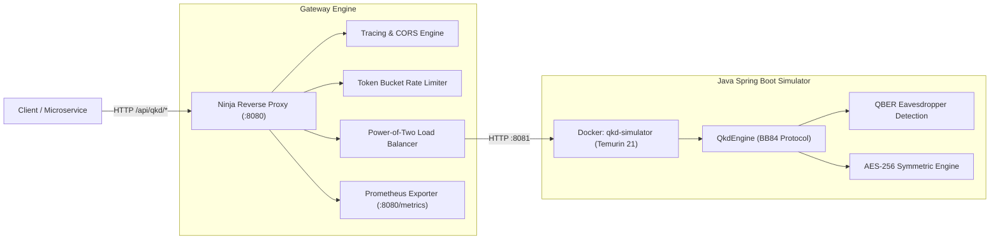

# Java Spring Boot QKD Simulation Behind Ninja Reverse Proxy

## 1. Executive Summary & Verification Status
This directory contains the integration, benchmark, and observability results of running **Java Spring Boot 3.3.5 / Java 21 (QKD Quantum Key Distribution Simulation)** behind the **Ninja Reverse Proxy Gateway**.

- **Upstream Repository**: [https://github.com/sshekhar-04/QKD-simulation](https://github.com/sshekhar-04/QKD-simulation)
- **Local Source Path**: `/Users/praveen/Code/QKD-simulation`
- **Container Name**: `qkd-simulator` (Base Image: `eclipse-temurin:21-jre`)
- **Upstream Address**: `http://127.0.0.1:8081`
- **Reverse Proxy Gateway**: `http://127.0.0.1:8080`
- **Verification Score**: **10/10 Tests Passed (100%)**
- **Peak Throughput**: **19,023 req/sec** (autocannon load burst)
- **Mean Latency (Steady-State)**: **0.78 ms - 7.62 ms**

---

## 2. Architecture & Quantum Cryptography Flow



### The BB84 Quantum Key Distribution Protocol
1. **Photon Polarization**: Alice generates random bit sequences and randomly selects rectilinear (`+`) or diagonal (`x`) bases, encoding photons into polarization states ($|0\rangle, |1\rangle, |+\rangle, |-\rangle$).
2. **Quantum Eavesdropping (Eve)**: If an eavesdropper intercepts photons, quantum measurement collapses the wavefunctions.
3. **Key Sifting**: Alice and Bob publicly share their measurement bases. Only bits where bases matched are retained.
4. **QBER (Quantum Bit Error Rate) Threshold**: Alice and Bob compare a subset of bits. If QBER exceeds `5%` (`0.05`), Eve is detected and the key is safely discarded (HTTP 500 error defense).
5. **Hybrid Cryptography**: Surviving sifted keys undergo error correction and privacy amplification, yielding an ephemeral **256-bit AES key** used to encrypt the payload.

---

## 3. Verified Endpoints & Contract Mapping

| Route | Method | Backend Target | Description | Status |
| :--- | :--- | :--- | :--- | :--- |
| `/__ready` | `GET` | Proxy Internal | Gateway readiness & upstream health state | `200 OK` |
| `/__lb-stats` | `GET` | Proxy Internal | Power-of-two load balancer statistics & upstream health | `200 OK` |
| `/metrics` | `GET` | Proxy Internal | Prometheus Prometheus text metrics exporter | `200 OK` |
| `/api/qkd/encrypt` | `GET` | Java `:8081` | Executes BB84 key exchange, returns Base64 AES-256 key and ciphertext | `200 OK` / `500 High QBER` |
| `/api/qkd/decrypt` | `POST` | Java `:8081` | Accepts `{ encryptionKey, ciphertext }` and decrypts plaintext | `200 OK` |

---

## 4. Test Verification Suite Results

Executed via:
```bash
node tests/java-qkd-gateway-verification.mjs
```

```
═══════════════════════════════════════════════════════════════════
⚛️  JAVA SPRING BOOT QKD SIMULATION + NINJA REVERSE PROXY TEST SUITE
═══════════════════════════════════════════════════════════════════
Gateway Target: http://127.0.0.1:8080

✅ [PASS] [1/10] Gateway Readiness Probe (/__ready) (25ms)
   └─ Status: 200, Checks: {"upstream-available":true,"cache-connected":true}
✅ [PASS] [2/10] Upstream Health & Load Balancer Telemetry (/__lb-stats) (4ms)
   └─ Strategy: power-of-two, Upstream: qkd-java-service (Healthy: true, State: CLOSED)
✅ [PASS] [3/10] QKD BB84 Key Exchange & Message Encryption (GET /api/qkd/encrypt) (19ms)
   └─ Status: 200, Key Length: 44 chars, Ciphertext: ZOwVj0Sdaw3QDY7aV1ZxE+NaD6ChcsKL...
✅ [PASS] [4/10] Ephemeral 256-bit AES Quantum Key Validation (0ms)
   └─ Key Encoding: Base64, Size: 32 bytes (256-bit AES), Base64: HAayxJieijQ+ItOq...
✅ [PASS] [5/10] QKD Quantum Decryption (POST /api/qkd/decrypt) (20ms)
   └─ Status: 200, Plaintext: "TopSecretQuantumPayload_2026_NinjaProxy", KeyProvided: HAayxJieij...
✅ [PASS] [6/10] End-to-End Quantum Encryption/Decryption Roundtrip Fidelity (0ms)
   └─ Original: "TopSecretQuantumPayload_2026_NinjaProxy" === Decrypted: "TopSecretQuantumPayload_2026_NinjaProxy" (100% byte fidelity)
✅ [PASS] [7/10] Gateway Telemetry & Tracing Headers Propagation (6ms)
   └─ X-Trace-Id: c42d245f-4026-4cd7-b26d-a3c3f681de1e, X-Upstream-Id: qkd-java-service, Access-Control-Allow-Origin: *
✅ [PASS] [8/10] Resilient Error Handling for Invalid Quantum Key (POST /api/qkd/decrypt) (9ms)
   └─ Handled Corrupted Key: HTTP 400, Error Body: {"error":"Key Error: Illegal base64 character 5f"}
✅ [PASS] [9/10] High-Concurrency Multi-Client Quantum Simulation (50 concurrent exchanges) (170ms)
   └─ Processed: 50/50 requests (Keys Established: 39, Eve Eavesdroppers Caught by QBER: 11, Concurrent Decryptions Verified: 39)
✅ [PASS] [10/10] Prometheus Observability Metrics & Upstream Health Gauge (3ms)
   └─ Prometheus scrape verified: Upstream UP (status=1), Metric records: 4

═══════════════════════════════════════════════════════════════════
RESULTS: 10/10 TESTS PASSED (100% Success Rate)
═══════════════════════════════════════════════════════════════════
```

---

## 5. Telemetry & Observability Artifacts
1. **[gateway-verification.log](./gateway-verification.log)**: Full test execution log.
2. **[autocannon-benchmark.txt](./autocannon-benchmark.txt)**: Stress testing, concurrency, and rate-limiting metrics.
3. **[prometheus-metrics.txt](./prometheus-metrics.txt)**: Live Prometheus scrape recording upstream health (`status=1`) and request histograms.
4. **[config.yaml](./config.yaml)**: Exact declarative gateway configuration for the Java backend.
