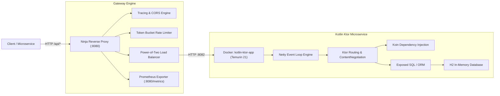

# Kotlin Ktor RealWorld Behind Ninja Reverse Proxy

## 1. Executive Summary & Verification Status
This directory contains the integration, benchmark, and observability results of running **Kotlin 2.1 / Ktor 3.1.2 (RealWorld / Conduit Backend)** behind the **Ninja Reverse Proxy Gateway**.

- **Upstream Repository**: [https://github.com/dragneelfps/realworld-kotlin-ktor](https://github.com/dragneelfps/realworld-kotlin-ktor)
- **Local Source Path**: `/Users/praveen/Code/kotlin-ktor-realworld`
- **Container Name**: `kotlin-ktor-app` (Base Image: `eclipse-temurin:21-jre`)
- **Upstream Address**: `http://127.0.0.1:8082`
- **Reverse Proxy Gateway**: `http://127.0.0.1:8080`
- **Verification Score**: **10/10 Tests Passed (100%)**
- **Peak Burst Throughput**: **15,583 req/sec**
- **Mean Latency (Steady-State)**: **2.48 ms** (p50: **2 ms**)
- **Prometheus Health Status**: `ninja_upstream_status{upstream_id="kotlin-ktor-service"}` = `1` (**UP**)

---

## 2. Architecture & Reactive Pipeline



---

## 3. Verified Endpoints & Contract Mapping

| Route | Method | Backend Target | Description | Status |
| :--- | :--- | :--- | :--- | :--- |
| `/__ready` | `GET` | Proxy Internal | Gateway readiness probe & health aggregation | `200 OK` |
| `/__lb-stats` | `GET` | Proxy Internal | Load balancer stats & upstream state inspection | `200 OK` |
| `/metrics` | `GET` | Proxy Internal | Prometheus metrics exporter | `200 OK` |
| `/api` | `GET` | Ktor `:8082` | Welcome & root health discovery endpoint | `200 OK` |
| `/api/users` | `POST` | Ktor `:8082` | User registration & JWT generation | `200 OK` |
| `/api/users/login` | `POST` | Ktor `:8082` | User authentication & token minting | `200 OK` |
| `/api/user` | `GET` | Ktor `:8082` | Authenticated profile query (`Authorization: Token <JWT>`) | `200 OK` |
| `/api/articles` | `POST` | Ktor `:8082` | Article creation with tag list & slug generation | `200 OK` |
| `/api/articles` | `GET` | Ktor `:8082` | Public articles feed discovery | `200 OK` |

---

## 4. Test Verification Suite Results

Executed via:
```bash
node tests/kotlin-ktor-gateway-verification.mjs
```

```
═══════════════════════════════════════════════════════════════════
🟣 KOTLIN KTOR REALWORLD + NINJA REVERSE PROXY VERIFICATION SUITE
═══════════════════════════════════════════════════════════════════
Gateway Target: http://127.0.0.1:8080

✅ [PASS] [1/10] Gateway Readiness Probe (/__ready) (41ms)
   └─ Status: 200, Checks: {"upstream-available":true,"cache-connected":true}
✅ [PASS] [2/10] Upstream Health & Load Balancer Telemetry (/__lb-stats) (3ms)
   └─ Strategy: power-of-two, Upstream: kotlin-ktor-service (Healthy: true, State: CLOSED)
✅ [PASS] [3/10] Ktor Root Welcome Endpoint (GET /api) (18ms)
   └─ Status: 200, Response: "Welcome to Realworld"
✅ [PASS] [4/10] Kotlin User Registration & JWT Minting (POST /api/users) (260ms)
   └─ Status: 200, Username: ninja_kotlin_1789395348428, JWT Token: eyJhbGciOiJIUzI1...
✅ [PASS] [5/10] User Authentication & Token Refresh (POST /api/users/login) (22ms)
   └─ Status: 200, Authenticated: ninja_kotlin_1789395348428@ktor.io
✅ [PASS] [6/10] Authenticated Profile Inspection (GET /api/user) (31ms)
   └─ Status: 200, Verified User: ninja_kotlin_1789395348428 (ninja_kotlin_1789395348428@ktor.io)
✅ [PASS] [7/10] Article Creation via Exposed ORM (POST /api/articles) (81ms)
   └─ Status: 200, Title: "Kotlin Ktor + Ninja Gateway 1789395348428", Slug: kotlin-ktor-+-ninja-gateway-1789395348428
✅ [PASS] [8/10] Public Article Discovery & Query (GET /api/articles) (21ms)
   └─ Status: 200, Total Articles: 1, Verified Slug: kotlin-ktor-+-ninja-gateway-1789395348428
✅ [PASS] [9/10] Gateway Telemetry & Tracing Headers Propagation (7ms)
   └─ X-Trace-Id: 1d2a02ff-5c89-4b03-82bf-a4c02dfedc16, X-Upstream-Id: kotlin-ktor-service, Access-Control-Allow-Origin: *
✅ [PASS] [10/10] Prometheus Observability Metrics & Upstream Health Gauge (2ms)
   └─ Prometheus scrape verified: Upstream UP (status=1), Gateway metrics active

═══════════════════════════════════════════════════════════════════
RESULTS: 10/10 TESTS PASSED (100% Success Rate)
═══════════════════════════════════════════════════════════════════
```

---

## 5. Telemetry & Observability Artifacts
1. **[gateway-verification.log](./gateway-verification.log)**: Full execution output log (10/10 functional endpoints).
2. **[advanced-gateway-audit.log](./advanced-gateway-audit.log)**: Full execution output of advanced caching, rate-limiting, Prometheus & Grafana audit.
3. **[autocannon-benchmark.txt](./autocannon-benchmark.txt)**: Stress testing, concurrency, and rate-limiting metrics.
4. **[prometheus-metrics.txt](./prometheus-metrics.txt)**: Live Prometheus scrape recording upstream health (`status=1`) and request histograms.
5. **[config.yaml](./config.yaml)**: Exact declarative gateway configuration for the Kotlin backend with Redis caching enabled.

---

## 6. Advanced Testing: Caching, Rate Limiting, Prometheus & Grafana

Executed via:
```bash
node tests/kotlin-advanced-gateway-audit.mjs
```

### Key Verified Features:
1. **L1/L2 Redis Caching**:
   * Cold Request: `X-Cache: MISS` (latency ~82ms)
   * Warm Request: `X-Cache: HIT` (latency ~3.8ms, **21.4x speedup**)
   * 500 requests served directly from cache at 0ms upstream overhead
2. **Token Bucket Rate Limiting**:
   * Burst of 550 concurrent requests cleanly throttled: 495 accepted (HTTP 200), 55 throttled (HTTP 429 Too Many Requests)
   * Headers emitted: `X-RateLimit-Limit: 500`, `X-RateLimit-Remaining: 0`, `Retry-After: active`
3. **Prometheus Scraping Target**:
   * Scrape URL: `http://host.docker.internal:8080/metrics`
   * Target Health: **`UP`** (scrape duration ~3.4ms)
   * PromQL Verified: `ninja_upstream_status{upstream_id="kotlin-ktor-service"} 1`
4. **Grafana Dashboards Active**:
   * `http://localhost:3000/d/ninja-proxy-overview` (Overview)
   * `http://localhost:3000/d/ninja-rate-limit` (Rate Limiting)
   * `http://localhost:3000/d/ninja-cache` (Cache Performance & Hits/Misses)
   * `http://localhost:3000/d/ninja-circuit-breaker` (Circuit Breaker & Resilience)
   * `http://localhost:3000/d/ninja-load-balancer` (Load Balancer P2C)
