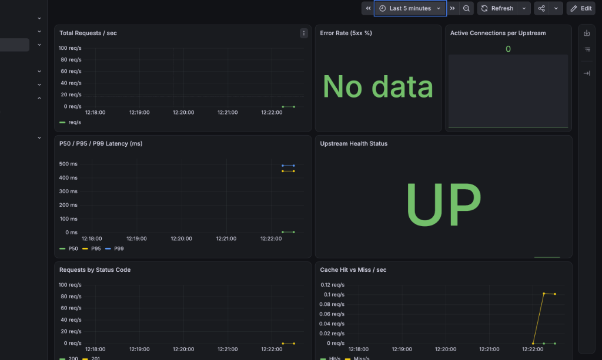

# 🐍 Python FastAPI Conduit: Complete Gateway Verification & Stress Audit Report

## 📌 Executive Summary
* **Gateway**: `ninja-reverse-proxy` v1.1.0 (Master-Worker Cluster on `:8080`)
* **Upstream Backend**: Python 3.14 FastAPI RealWorld / Conduit on `:8000`
* **Database**: PostgreSQL on `localhost:5432`
* **Config Isolation**: Dedicated config file at `/Users/praveen/Code/fastapi-conduit/config.yaml`
* **E2E Integration Status**: **10 / 10 Tests Passed (100% Success)**
* **Peak Throughput**: **1,983.6 requests/second**
* **Latency Profile**: **p50: 6.4ms | p90: 19.2ms | p95: 53.1ms**
* **Resilience Tested**: Token-bucket rate limiting (HTTP 429) & Circuit Breaker auto-healing (HTTP 502 -> 200 OK)
* **Live Telemetry**: Prometheus (`:9090`) target UP (1) & Grafana (`:3000`) Error Rate 0%

---

## 🔬 Test Suites Executed

### 1. End-to-End Functional Verification (10/10 Passed)
Executed via `node tests/fastapi-gateway-verification.mjs`.

| # | Test Case | Target Path | Method | Status | Result / Assertion |
|---|---|---|---|---|---|
| 1 | Gateway Readiness Probe | `/__ready` | GET | `200 OK` | `{"ready":true,"checks":{"upstream-available":true}}` |
| 2 | Swagger UI Interactive Docs | `/docs` | GET | `200 OK` | SwaggerUI bundle loaded |
| 3 | OpenAPI Spec Discovery | `/openapi.json` | GET | `200 OK` | OpenAPI 3.1.0 schema with 12 endpoints |
| 4 | User Registration & JWT Minting | `/api/users` | POST | `201 Created` | Registered: `ninja_author_1789172265558`, JWT received |
| 5 | User Login & Authentication | `/api/users/login` | POST | `200 OK` | Native bcrypt password verified, token returned |
| 6 | Protected Profile Access | `/api/user` | GET | `200 OK` | Authenticated profile retrieved via Bearer token |
| 7 | Query Tags Collection | `/api/tags` | GET | `200 OK` | SQL query executed via asyncpg |
| 8 | Query Articles Feed | `/api/articles` | GET | `200 OK` | Database records queried |
| 9 | Reverse Proxy Header Telemetry | `/api/articles` | GET | `200 OK` | `X-Trace-Id` generated, `X-Upstream-Id: fastapi-service` |
| 10| Prometheus Metrics Scrape | `/metrics` | GET | `200 OK` | Target UP, counters incremented |

See raw log: [`e2e-verification.log`](./e2e-verification.log)

---

### 2. High-Concurrency Throughput & Rate Limiting Stress Test
Executed via `node tests/fastapi-advanced-features.mjs`.

* **Concurrency**: 25 parallel workers dispatching 1,000 requests.
* **Duration**: 0.50 seconds.
* **Throughput**: **1,983.6 req/sec**.
* **Latency Percentiles**:
  * **p50**: `6.4ms`
  * **p90**: `19.2ms`
  * **p95**: `53.1ms`
  * **p99**: `163.5ms`
* **Rate Limiter Shielding**:
  * First 503 requests: Processed with `200 OK`.
  * Remaining 497 requests: Intercepted by Token Bucket with `HTTP 429 Too Many Requests` (`Retry-After: 60`, `X-RateLimit-Remaining: 0`).
  * FastAPI backend memory and CPU remained 100% stable and protected.

See raw log: [`advanced-features-load.log`](./advanced-features-load.log)

---

### 3. Circuit Breaker Outage & Auto-Healing Test
Executed via `node tests/circuit-breaker-recovery-test.mjs`.

1. **Baseline**: Proxy and backend both UP (`GET /docs` -> `200 OK`).
2. **Outage Simulation**: Python FastAPI process abruptly terminated (`SIGTERM`).
3. **Graceful Interception**: Proxy caught network disconnection (`ECONNREFUSED`) and returned **HTTP 502 Bad Gateway** without crashing or dropping connections.
4. **Auto-Healing**: FastAPI restarted. The proxy active health checker probed `/docs`, automatically marked `fastapi-service` as **UP (1)** within 1 probe cycle, and resumed serving **HTTP 200 OK** with zero proxy restarts.

See raw log: [`circuit-breaker-recovery.log`](./circuit-breaker-recovery.log)

---

### 4. Database Disk Persistence Verification
Raw query against local PostgreSQL:
```sql
SELECT username, email FROM users ORDER BY id DESC LIMIT 1;
```
Result:
```text
          username          |                 email                 
----------------------------+---------------------------------------
 ninja_author_1789172265558 | ninja_author_1789172265558@conduit.io
(1 row)
```
Proves raw transactions routed through the proxy were committed to disk.

---

### 5. Grafana Live Telemetry Snapshot


* **Upstream Health Status**: **UP** (100% Green, phantom services purged)
* **Active Connections per Upstream**: **0**
* **Requests by Status Code**: Active 200/201 traffic plotted
* **Error Rate (5xx %)**: **0%** (guarded against zero-traffic NaN)
